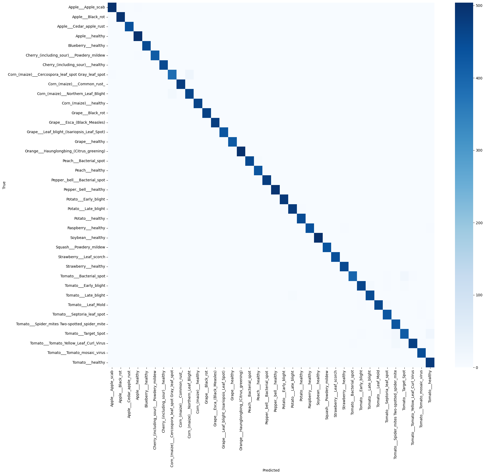
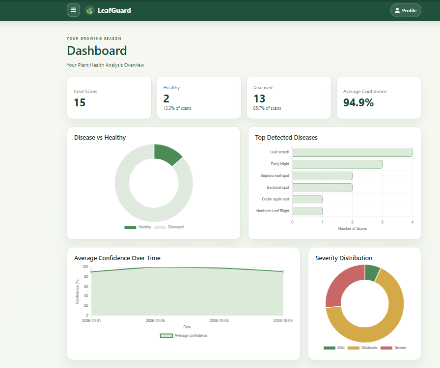
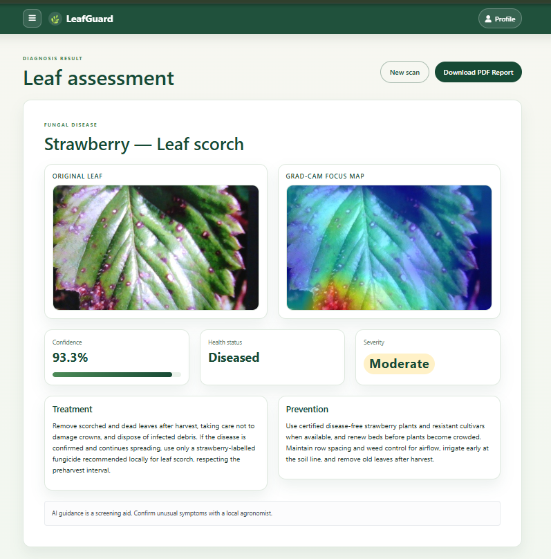
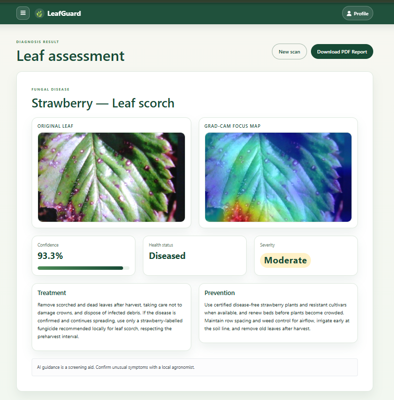

<<<<<<< HEAD
# LeafGuard AI — DeepLeaf CNN: Plant Disease Classification

**LeafGuard AI** is a web application for screening plant-leaf images with a trained ResNet50 image-classification model. Users can upload a leaf photo or capture one in the browser, review the predicted class and Grad-CAM visualization, and keep results in an account-based history.

This repository includes a Flask application, model files, a class-index mapping, and screenshots of the interface and model evaluation. It is intended as a college project and portfolio demonstration.

> **Disclaimer:** This application provides an AI-assisted screening result, not a confirmed agricultural diagnosis. Use the prediction as a starting point and consult a qualified agricultural professional or local extension service before making important treatment decisions.

## Table of contents

- [Key features](#key-features)
- [Screenshots](#screenshots)
- [Technologies used](#technologies-used)
- [System workflow](#system-workflow)
- [Model and dataset information](#model-and-dataset-information)
- [Explainable AI with Grad-CAM](#explainable-ai-with-grad-cam)
- [Treatment and prevention recommendations](#treatment-and-prevention-recommendations)
- [Installation and setup](#installation-and-setup)
- [Run the application](#run-the-application)
- [Project structure](#project-structure)
- [Configuration and model files](#configuration-and-model-files)
- [Limitations](#limitations)
- [Future enhancements](#future-enhancements)

## Key features

- Predicts among **38 plant and leaf-condition classes** represented in the supplied class mapping.
- Accepts JPEG and PNG leaf images, including browser camera captures.
- Displays prediction class, confidence, health category, and severity.
- Generates a Grad-CAM heatmap to visualize image regions influencing the prediction.
- Provides class-specific treatment and prevention guidance in the result view.
- Offers account-based assessment history and dashboard analytics.
- Generates a downloadable PDF report for a saved assessment.
- Stores application records in SQLite and uploaded assessment images locally.
- Displays five processing stages while an image is being analyzed.

## Screenshots

The screenshots below are existing project files in the repository root. Their exact names are used so that the links also work on case-sensitive hosting platforms.

### Model Evaluation

Confusion matrix supplied with the project.



### Dashboard

Authenticated analytics and prediction statistics for the signed-in account.



### Diagnosis Results

Prediction detail page, including the class, confidence, Grad-CAM visualization, and explanation where shown.



### Prediction History

Previous diagnosis records saved to the signed-in user's history.



## Technologies used

| Area | Technologies confirmed in the project |
| --- | --- |
| Backend and web framework | Python, Flask |
| Model inference | TensorFlow/Keras, ResNet50 |
| Authentication and persistence | Flask-Login, Flask-SQLAlchemy, SQLite |
| Image handling | Pillow, NumPy, OpenCV |
| Frontend | HTML, CSS, JavaScript, Bootstrap |
| Dashboard charts | Chart.js |
| PDF reports | xhtml2pdf |

## System workflow

1. A user creates an account or signs in.
2. The user uploads a JPEG/PNG file or captures an image using the browser camera.
3. The server checks the file extension, image format, and upload-size limit (8 MB).
4. The image is converted to RGB, resized to the loaded model's input dimensions, and prepared using ResNet50 preprocessing.
5. The trained model produces class probabilities. Inputs below the app's 40% maximum-confidence threshold are rejected rather than saved as diagnoses.
6. Grad-CAM produces a heatmap for the predicted class, and the application assembles the result and recommendations.
7. The assessment and visualizations are stored locally and associated with the signed-in account. The user can review the result, view history and dashboard summaries, or download a PDF report.

## Model and dataset information

- **Architecture:** ResNet50 image classifier, loaded with TensorFlow/Keras.
- **Active model bundle:** [`models/Finetune_Epoch 04.keras/`](models/Finetune_Epoch%2004.keras/) containing the model configuration, metadata, and weights.
- **Class mapping:** [`models/Final_class_indices.json`](models/Final_class_indices.json).
- **Class count:** The mapping assigns indices 0–37, for 38 classes spanning Apple, Blueberry, Cherry, Corn, Grape, Orange, Peach, Bell Pepper, Potato, Raspberry, Soybean, Squash, Strawberry, and Tomato.
- **Additional supplied model:** [`models/Final_Resnet_50.keras/`](models/Final_Resnet_50.keras/) is present in the repository; the Flask app is configured to load the fine-tuned model bundle above.
- **Evaluation artifacts:** [`confusion_matrix.png`](confusion_matrix.png) and [`classification_report.txt`](classification_report.txt) are supplied. This README does not claim a dataset size or performance score.

The repository does not identify the original dataset source or document its train/validation/test split. PlantVillage or New Plant Diseases Dataset provenance should therefore not be assumed without confirmation from the project author.

## Explainable AI with Grad-CAM

Grad-CAM (Gradient-weighted Class Activation Mapping) uses gradients associated with the predicted class to create a coarse heatmap over the input image. The application overlays this heatmap on the uploaded leaf image to show regions that influenced the model's prediction.

The visualization is an aid for inspecting model behavior. It does **not** prove that a disease is present, explain every model decision, or guarantee that the predicted class is correct.

## Treatment and prevention recommendations

The application associates supported class labels with treatment and prevention text defined in its predictor module. Recommendations are general guidance displayed alongside a model prediction; they are not generated from a verified field diagnosis.

Always confirm the likely cause of symptoms before treating a crop. Follow local agricultural guidance, product labels, registration requirements, and harvest restrictions. When the model class has no dedicated guidance entry, the application uses general inspection and prevention advice.

## Installation and setup

### 1. Clone the repository

Replace `<repository-url>` with the clone URL for this project:

```bash
git clone <repository-url> leafguard
cd leafguard
```

### 2. Create and activate a virtual environment

**Windows PowerShell**

```powershell
py -3.13 -m venv .venv
.\.venv\Scripts\Activate.ps1
```

**macOS / Linux**

```bash
python3.13 -m venv .venv
source .venv/bin/activate
```

The project's current virtual environment uses Python 3.13.7. TensorFlow wheel availability depends on the operating system and Python version; use a Python version supported by the TensorFlow release available for your platform if 3.13 cannot install successfully.

### 3. Install dependencies

```bash
python -m pip install --upgrade pip
python -m pip install -r requirements.txt
```

## Run the application

From the repository root, with the virtual environment activated:

```bash
python run.py
```

The entry point is [`run.py`](run.py), which creates the Flask application and starts its development server. Open **http://127.0.0.1:5000/** in your browser, create an account, then upload or capture a leaf image to start an assessment.

The development server runs with Flask debug mode enabled. Do not expose it directly to the public internet; production deployment requires a production WSGI server and production-safe configuration.

## Project structure

```text
.
├── app/
│   ├── __init__.py                 # Flask app factory and configuration
│   ├── auth.py                     # Registration, login, and logout
│   ├── main.py                     # Diagnosis, dashboard, history, and reports
│   ├── models.py                   # SQLAlchemy user and prediction models
│   ├── predictor.py                # Model inference, Grad-CAM, and guidance
│   ├── static/
│   │   ├── leaf-examples/          # Example leaf images used by the UI
│   │   └── style.css
│   └── templates/                  # Flask/Jinja HTML pages
├── models/
│   ├── Final_Resnet_50.keras/      # Additional supplied model bundle
│   ├── Final_class_indices.json    # Output index-to-class mapping
│   └── Finetune_Epoch 04.keras/    # Model bundle loaded by the app
├── Training_leafs/                 # Sample leaf images in the repository
├── Dashboard.png                   # Dashboard screenshot
├── Diagnosis_Result.png            # Diagnosis screenshot
├── History.png                     # History screenshot
├── confusion_matrix.png            # Evaluation screenshot
├── classification_report.txt       # Per-class evaluation report
├── requirements.txt                # Python dependencies
├── run.py                          # Application entry point
├── test_model_init.py
├── test_model_load.py
└── test_phase5_comprehensive.py
```

At runtime, the app creates or uses `instance/` for the SQLite database and account-scoped uploaded images. This directory is application data, not model or source code.

## Configuration and model files

The app reads these environment variables:

| Variable | Purpose |
| --- | --- |
| `SECRET_KEY` | Flask session signing. Set a unique, private value before deployment; do not commit it. |
| `DATABASE_URL` | SQLAlchemy database URL. If unset, the app uses `instance/plantdoctor.sqlite`. |

No environment-variable override is implemented for the model or mapping paths. The application expects:

- `models/Finetune_Epoch 04.keras/` with `config.json` and `model.weights.h5` (the bundle also contains `metadata.json`).
- `models/Final_class_indices.json` with the class names and output-index mapping.

These files are present in the inspected project. If a clone or distribution omits model assets, obtain the authorized model bundle and place it at the expected path before starting the app. The original model directory is also included, but it is not the configured default.

## Limitations

- Predictions depend on image quality, framing, lighting, and similarity to the model's training data.
- The 38 mapped labels define the available prediction categories; conditions outside these classes may be misclassified or rejected.
- The 40% threshold helps reject some uncertain inputs but does not establish that an image contains a leaf or that a prediction is correct.
- Grad-CAM is a coarse visual explanation, not a clinical/agronomic validation method.
- Dataset source, split methodology, and independently verified performance results are not documented in this repository.
- SQLite and the Flask development server are intended for local evaluation, not high-volume or public production use.

## Future enhancements

- Document dataset provenance, data splits, and reproducible evaluation methodology.
- Add additional crop classes and validate the model with field-collected images.
- Evaluate calibration and uncertainty handling beyond the current confidence threshold.
- Provide production deployment guidance, database migrations, and operational monitoring.
- Improve accessibility and support localization for crop guidance.
=======
# DeepLeaf-CNN-Plant-Disease-Classification
LeafGuard AI is a Flask-based plant disease detection web app using ResNet50 and Grad-CAM. It classifies leaf diseases, explains predictions visually, provides treatment and prevention recommendations, and includes user authentication, prediction history, an interactive dashboard, and downloadable PDF reports.
>>>>>>> e56479c310744de2c6e2c44487797958ac5468d3
